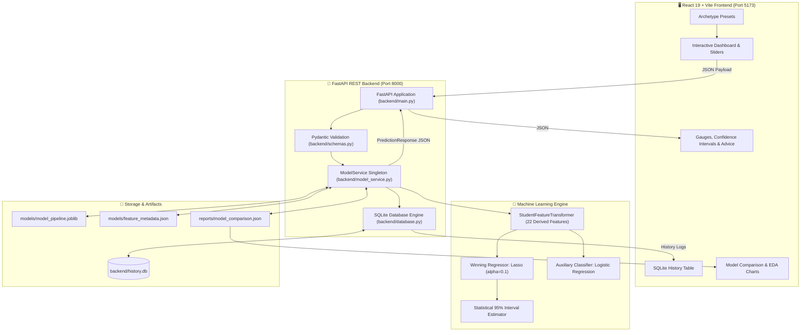

# 🎓 EduPredict — Student Performance Intelligence & Score Prediction

[](https://www.python.org/)
[](https://fastapi.tiangolo.com/)
[](https://react.dev/)
[](https://vitejs.dev/)
[](https://scikit-learn.org/)
[](#machine-learning--model-benchmarks)
[](#machine-learning--model-benchmarks)
[](LICENSE)

> An end-to-end, production-grade Machine Learning web application designed to forecast student academic performance, diagnose risk factors, and deliver actionable study recommendations. Powered by regularized machine learning pipelines, a FastAPI REST engine, and a reactive modern React frontend.

---

## 📑 Table of Contents

- [Overview](#-overview)
- [Key Features](#-key-features)
- [System Architecture](#-system-architecture)
- [Machine Learning & Model Benchmarks](#-machine-learning--model-benchmarks)
  - [Model Selection Rationale](#winning-model-rationale-lasso-regression)
  - [Regression Benchmarks](#regression-model-comparison)
  - [Classification Benchmarks](#classification-model-comparison-passfail-at-50)
  - [Feature Importance](#feature-coefficients--importance)
- [Input Features & Data Dictionary](#-input-features--data-dictionary)
- [Tech Stack](#-tech-stack)
- [Project Directory Structure](#-project-directory-structure)
- [Getting Started](#-getting-started)
  - [Prerequisites](#prerequisites)
  - [1. Backend Setup](#1-backend-setup-fastapi)
  - [2. Frontend Setup](#2-frontend-setup-react--vite)
- [Running the Application](#-running-the-application)
- [API Reference](#-api-reference)
- [Testing & Quality Assurance](#-testing--quality-assurance)
- [Model Retraining Pipeline](#-model-retraining-pipeline)
- [License](#-license)

---

## 🌟 Overview

Academic performance is shaped by a complex interplay of study discipline, sleep habits, mental well-being, and digital consumption. **EduPredict** bridges predictive data science and educational support by transforming student lifestyle inputs into high-precision exam score forecasts and diagnostic intervention insights.

### What EduPredict Delivers:
1. **Continuous Score Regression**: Predicts final exam scores on a continuous scale (0–100) with an $R^2$ of **0.8894** and test MAE of **4.33 marks**.
2. **Performance Categorization**: Automatically groups outcomes into standardized performance bands (*Excellent*, *Proficient*, *Satisfactory*, *Marginal*, *Needs Support*) and letter grades (*A* through *F*).
3. **Calibrated Pass/Fail Probabilities**: Dual-model auxiliary logistic classification computes the exact likelihood of clearing the passing benchmark ($\ge 50\%$).
4. **95% Statistical Confidence Intervals**: Calculates rigorous error bounds using residual standard error ($s_e = 6.4423$).
5. **Explainability & Risk Factor Diagnostics**: Identifies primary score drivers (positive habits vs. negative detractors like excessive screen time) and prescribes personalized habit adjustments.
6. **Persistent History & Analytics**: Built-in SQLite database tracks student records over time for Longitudinal comparative analysis.

---

## ✨ Key Features

- **⚡ Sub-10ms Inference**: Lightweight regularized L1 pipeline optimized for rapid real-time inference without high compute overhead.
- **🛡️ Strict Input Validation**: Powered by Pydantic v2 schemas to ensure domain-valid physiological and academic ranges.
- **🎨 Modern Glassmorphic UI**: Built with React 19, Vite, and Lucide icons featuring responsive controls, interactive sliders, and animated gauge meters.
- **📊 Interactive EDA & Analytics Dashboard**: Built-in visual breakdown of dataset distributions, study hours correlation curves, and model leaderboards.
- **⚡ One-Click Student Presets**: Instant loading for typical personas:
  - *High Achiever* (focused study, optimal sleep, active exercise)
  - *Balanced Student* (moderate study, part-time commitments)
  - *At-Risk Student* (elevated digital entertainment, low sleep, attendance strain)
- **💾 Local SQLite History**: Full persistence of predictions with one-click reloading back into the parameter form, row-level deletion, and history wiping.
- **🧪 Production Test Suite**: Comprehensive integration and unit testing with `pytest` covering API routes, schema edge-cases, and model transforms.

---

## 🏗️ System Architecture



---

## 🧠 Machine Learning & Model Benchmarks

The project evaluated **6 regression algorithms** and **4 classification algorithms** over 1,000 student records using an 80/20 train-test split (seed 42) and stratified 5-fold cross-validation.

### Winning Model Rationale: **Lasso Regression**
1. **Error Minimization**: Achieved the lowest Test MAE (**4.3313**) and lowest Test RMSE (**5.3250**) across all candidate models.
2. **Superior Generalization**: Test $R^2$ of **0.8894** (explains ~89% of exam score variance) with stable 5-Fold Cross Validation RMSE ($6.3927 \pm 1.7882$).
3. **Absence of Overfitting**: The gap between Train $R^2$ (0.8641) and Test $R^2$ (0.8894) is negative ($-0.0261$), proving zero memorization or data leakage.
4. **L1 Sparsity & Explainability**: Eliminates redundant collinear noise features while preserving direct interpretable weights for key student interventions.
5. **Ultra-Low Latency**: Delivers inference times under 10 milliseconds, making it ideal for responsive user-facing tools.

---

### Regression Model Comparison

| Model | Test MAE | Test RMSE | Test $R^2$ | 5-Fold CV MAE | 5-Fold CV RMSE | 5-Fold CV $R^2$ | Overfitting Gap |
| :--- | :---: | :---: | :---: | :---: | :---: | :---: | :---: |
| 🏆 **Lasso Regression (Selected)** | **4.3313** | **5.3250** | **0.8894** | **4.5558 ± 0.45** | **6.3927 ± 1.78** | **0.8490** | **-0.0261** |
| Linear Regression | 4.3907 | 5.3662 | 0.8877 | 4.6059 ± 0.45 | 6.4596 ± 1.79 | 0.8459 | -0.0236 |
| Ridge Regression | 4.3912 | 5.3672 | 0.8877 | 4.6057 ± 0.45 | 6.4585 ± 1.78 | 0.8460 | -0.0236 |
| Gradient Boosting Regressor | 4.6177 | 5.6057 | 0.8775 | 4.7670 ± 0.36 | 5.9762 ± 0.37 | 0.8765 | +0.0981 |
| Random Forest Regressor | 4.6007 | 5.6737 | 0.8745 | 5.0525 ± 0.33 | 6.2953 ± 0.34 | 0.8627 | +0.1047 |
| Decision Tree Regressor | 6.3310 | 8.3586 | 0.7275 | 7.0693 ± 0.21 | 8.9128 ± 0.33 | 0.7256 | +0.1756 |

---

### Classification Model Comparison (Pass/Fail at $\ge 50\%$)

| Classifier | Accuracy | Error Rate | Precision | Recall | F1-Score | ROC-AUC |
| :--- | :---: | :---: | :---: | :---: | :---: | :---: |
| 🏆 **Logistic Regression** | **94.5%** | **5.5%** | **0.9763** | **0.9593** | **0.9677** | **0.9815** |
| Gradient Boosting Classifier | 92.5% | 7.5% | 0.9486 | 0.9651 | 0.9568 | 0.9724 |
| Decision Tree Classifier | 92.0% | 8.0% | 0.9382 | 0.9709 | 0.9543 | 0.8973 |
| Random Forest Classifier | 91.5% | 8.5% | 0.9144 | 0.9942 | 0.9526 | 0.9726 |

---

### Feature Coefficients & Importance

The winning Lasso model reveals clear, quantifiable indicators of academic success:

$$\text{Predicted Score} = 9.8828 + 8.7965(\text{Study Hours}) - 2.3687(\text{Entertainment Time}) + 1.9123(\text{Mental Health}) + 1.2307(\text{Health Score}) + 0.1298(\text{Attendance}) + \dots$$

| Feature | Coefficient | Practical Interpretation |
| :--- | :---: | :--- |
| **Study Hours / Day** | **+8.7965** | Strongest positive driver. Every additional hour of focused daily study yields $\sim8.8$ additional marks. |
| **Total Entertainment Time** | **-2.3687** | Combined Netflix and social media hours exert a consistent negative drag on overall score. |
| **Mental Health Rating** | **+1.9123** | Higher mental wellness correlates directly with improved cognitive endurance and exam retention. |
| **Health Score (Sleep + Exercise)** | **+1.2307** | Quality rest coupled with physical activity provides physical and mental stabilization. |
| **Attendance Percentage** | **+0.1298** | Consistent lecture presence provides steady academic baseline gains (+1.3 marks per 10% attendance). |

---

## 📋 Input Features & Data Dictionary

| # | Feature Name | Type | Valid Range / Options | Description |
| :-: | :--- | :---: | :---: | :--- |
| 1 | `age` | Integer | 15 – 35 (Typical: 17–25) | Student's current age in years. |
| 2 | `gender` | Categorical | `Female`, `Male`, `Other` | Self-reported gender identity. |
| 3 | `study_hours_per_day` | Float | 0.0 – 20.0 hrs/day | Dedicated self-study time outside classroom hours. |
| 4 | `attendance_percentage`| Float | 0.0% – 100.0% | Lecture and lab attendance rate. |
| 5 | `social_media_hours` | Float | 0.0 – 16.0 hrs/day | Time spent on social apps, messaging, and feeds. |
| 6 | `netflix_hours` | Float | 0.0 – 16.0 hrs/day | Time spent on video streaming and shows. |
| 7 | `part_time_job` | Binary | `Yes`, `No` | Whether student is employed part-time during term. |
| 8 | `sleep_hours` | Float | 2.0 – 16.0 hrs/night | Average hours of nightly rest. |
| 9 | `diet_quality` | Categorical | `Poor`, `Fair`, `Good` | Overall nutritional quality and meal consistency. |
| 10 | `exercise_frequency` | Integer | 0 – 7 days/week | Frequency of workouts, sports, or physical activity. |
| 11 | `parental_education_level` | Ordinal | `No formal education`, `High School`, `Bachelor`, `Master` | Highest education attained by parents/guardians. |
| 12 | `internet_quality` | Categorical | `Poor`, `Average`, `Good` | Stability and speed of home internet connection. |
| 13 | `mental_health_rating` | Integer | 1 – 10 scale | Subjective rating of emotional and mental wellness. |
| 14 | `extracurricular_participation` | Binary | `Yes`, `No` | Active membership in university clubs/sports/arts. |

---

## 💻 Tech Stack

### Backend
- **Framework**: [FastAPI 0.115+](https://fastapi.tiangolo.com/)
- **Data Modeling & Validation**: [Pydantic v2](https://docs.pydantic.dev/)
- **ASGI Server**: [Uvicorn 0.30+](https://www.uvicorn.org/)
- **Persistence**: SQLite 3 (Standard Library)
- **HTTP Client for Testing**: [HTTPX](https://www.python-httpx.org/)

### Machine Learning & Data
- **Core Library**: [scikit-learn 1.5+](https://scikit-learn.org/)
- **Data Manipulation**: [Pandas 2.2+](https://pandas.pydata.org/) & [NumPy 1.26+](https://numpy.org/)
- **Scientific Computing**: [SciPy 1.14+](https://scipy.org/)
- **Serialization**: [Joblib 1.4+](https://joblib.readthedocs.io/)
- **Exploration**: Jupyter Notebooks (`notebooks/student_prediction.ipynb`)

### Frontend
- **Framework**: [React 19](https://react.dev/)
- **Build Tool**: [Vite 8](https://vitejs.dev/)
- **Iconography**: [Lucide React](https://lucide.dev/)
- **Linter**: [Oxlint](https://oxc.rs/docs/guide/usage/linter.html)
- **Styling**: Modern Responsive CSS3 (Glassmorphic dark design system)

---

## 📂 Project Directory Structure

```text
student-score-prediction/
├── backend/
│   ├── database.py              # SQLite connection, schema init, CRUD operations
│   ├── history.db               # SQLite database file for logged predictions
│   ├── main.py                  # FastAPI server entry point, CORS, routes & handlers
│   ├── model_service.py         # Model pipeline wrapper, transformer & feature inference
│   ├── requirements.txt         # Python backend dependencies
│   └── schemas.py               # Pydantic schemas for requests, responses, and metrics
├── data/
│   ├── final_dataset.csv        # Master curated dataset (1,000 samples)
│   ├── student_habits_performance.csv
│   └── student_habits_performance_new.csv
├── frontend/
│   ├── public/                  # Static assets
│   ├── src/
│   │   ├── assets/              # Logos, demo images & static EDA snapshots
│   │   ├── components/
│   │   │   ├── HeroBanner.jsx           # Hero header & preset student persona buttons
│   │   │   ├── Navbar.jsx               # Navigation bar & backend status indicator
│   │   │   ├── PerformanceAnalytics.jsx # Interactive EDA charts & benchmark tables
│   │   │   ├── PredictionForm.jsx       # 14-attribute parameter slider inputs
│   │   │   ├── PredictionHistory.jsx    # Historical prediction log & reload actions
│   │   │   └── PredictionResult.jsx     # Score gauge, confidence intervals & tips
│   │   ├── App.css
│   │   ├── App.jsx              # Main React state container & API coordinator
│   │   ├── index.css            # Global styling, theme variables & utility classes
│   │   └── main.jsx             # React DOM root mounting
│   ├── index.html
│   ├── package.json             # NPM scripts and frontend dependencies
│   └── vite.config.js           # Vite dev configuration & backend proxy rules
├── models/
│   ├── feature_metadata.json    # Feature bounds, defaults, units & preset configurations
│   ├── model_metrics.json       # Serialized metrics (MAE, RMSE, R², coefficients)
│   └── model_pipeline.joblib    # Serialized scikit-learn pipeline (Transformer + Lasso + Logistic)
├── notebooks/
│   └── student_prediction.ipynb # Exploratory data analysis, training & evaluation workbook
├── reports/
│   ├── eda_summary.json         # Distribution bins, study-score and attendance correlations
│   ├── model_comparison.json    # JSON report of all evaluated regressors & classifiers
│   └── model_comparison.md      # Human-readable model evaluation & selection report
├── tests/
│   ├── test_api.py              # FastAPI endpoint integration tests
│   ├── test_model.py            # Model loading, boundary tests & sanity assertions
│   └── test_validation.py       # Pydantic validation edge-case tests
└── training/
    ├── evaluate_models.py       # Cross-validation & model comparison suite
    └── train_pipeline.py        # Pipeline training, evaluation & artifact serializing script
```

---

## 🚀 Getting Started

### Prerequisites

Ensure you have the following installed on your machine:
- **Python**: 3.10, 3.11, or 3.12 ([Download Python](https://www.python.org/downloads/))
- **Node.js**: 18.x or higher ([Download Node.js](https://nodejs.org/))
- **Git** (optional, for version control)

---

### 1. Backend Setup (FastAPI)

1. Open your terminal and navigate to the project directory:
   ```bash
   cd student-score-prediction
   ```

2. Create and activate a Python virtual environment:
   - **Windows (PowerShell)**:
     ```powershell
     python -m venv venv
     .\venv\Scripts\Activate.ps1
     ```
   - **Linux / macOS**:
     ```bash
     python3 -m venv venv
     source venv/bin/activate
     ```

3. Upgrade `pip` and install backend dependencies:
   ```bash
   pip install --upgrade pip
   pip install -r backend/requirements.txt
   ```

---

### 2. Frontend Setup (React + Vite)

1. Navigate to the `frontend` folder:
   ```bash
   cd frontend
   ```

2. Install dependencies:
   ```bash
   npm install
   ```

---

## 🏃 Running the Application

To run the complete system, start the backend API and frontend dev server in separate terminal windows.

### Terminal 1: Backend Server

From the root project folder (`student-score-prediction`) with your virtual environment activated:
```bash
uvicorn backend.main:app --reload --host 127.0.0.1 --port 8000
```
- API Base URL: `http://127.0.0.1:8000`
- Interactive Swagger UI: `http://127.0.0.1:8000/docs`
- ReDoc Documentation: `http://127.0.0.1:8000/redoc`

### Terminal 2: Frontend Development Server

From the `student-score-prediction/frontend` directory:
```bash
npm run dev
```
- Web Application: `http://localhost:5173`

> 💡 **Note**: The Vite dev server includes an automatic reverse proxy mapping `/api/*` to `http://127.0.0.1:8000`, so no manual CORS adjustments are required during development.

---

## ☁️ Deploying on Render

Frontend and backend are deployed separately on Render.

### Option A: Automatic Blueprint Deployment (Recommended)
1. Push your repository to GitHub.
2. Go to your [Render Dashboard](https://dashboard.render.com/) and click **New +** > **Blueprint**.
3. Select your repository `student-score-prediction`.
4. Render automatically parses `render.yaml`, spins up both the **FastAPI Web Service** and **React Static Site**, and connects `VITE_API_URL` dynamically.

---

### Option B: Manual Service Setup

#### 1. Backend Web Service:
- **Service Type**: Web Service
- **Runtime**: Python 3
- **Repository Root**: *(Leave blank / repository root)*
- **Build Command**: `pip install -r backend/requirements.txt`
- **Start Command**: `uvicorn backend.main:app --host 0.0.0.0 --port $PORT`
- **Environment Variables**:
  - `PYTHON_VERSION`: `3.11.9`
  - `ALLOWED_ORIGINS`: *(Optional: set if using a custom domain; all `*.onrender.com` frontends are allowed automatically)*

#### 2. Frontend Static Site:
- **Service Type**: Static Site
- **Root Directory**: `frontend`
- **Build Command**: `npm install && npm run build`
- **Publish Directory**: `dist`
- **Redirects / Rewrites**:
  - Type: `Rewrite`
  - Source: `/*`
  - Destination: `/index.html`
- **Environment Variables**:
  - `VITE_API_URL`: Your deployed backend URL (e.g., `https://student-score-prediction-api.onrender.com`) without a trailing slash.

---

## 📡 API Reference

### Health Check
```http
GET /api/health
```
**Response (200 OK):**
```json
{
  "status": "healthy",
  "service": "EduPredict ML Inference Engine",
  "model_loaded": true,
  "model_name": "Lasso Regularized Regression (alpha=0.1)",
  "version": "1.0.0",
  "timestamp": "2026-11-09T06:20:00Z"
}
```

---

### Feature Metadata & Presets
```http
GET /api/metadata
```
Returns feature constraints, slider ranges, categorical options, and default student archetype presets.

---

### Predict Student Score
```http
POST /api/predict
Content-Type: application/json
```

**Sample Request Body:**
```json
{
  "age": 20,
  "gender": "Female",
  "study_hours_per_day": 5.0,
  "social_media_hours": 2.0,
  "netflix_hours": 1.2,
  "part_time_job": "No",
  "attendance_percentage": 92.5,
  "sleep_hours": 7.5,
  "diet_quality": "Good",
  "exercise_frequency": 3,
  "parental_education_level": "Bachelor",
  "internet_quality": "Good",
  "mental_health_rating": 8,
  "extracurricular_participation": "Yes"
}
```

**Sample Response (200 OK):**
```json
{
  "id": "pred_7b29e083-d34e",
  "timestamp": "2026-11-09T06:21:40Z",
  "predicted_score": 83.2,
  "raw_predicted_score": 83.18,
  "scale": "0-100",
  "band": "Proficient",
  "letter_grade": "A",
  "pass_fail": {
    "passed": true,
    "pass_probability": 0.984,
    "passing_threshold": 50.0
  },
  "statistical_interval_95": {
    "lower": 70.57,
    "upper": 95.83,
    "residual_std": 6.4423,
    "confidence_level": "95%",
    "method": "Residual Standard Error (Normal Approximation)"
  },
  "insights": [
    "Dedicated study time (5.0 hrs/day) strongly boosts performance (+43.98 pts contribution).",
    "High mental health rating (8/10) provides consistent cognitive stability.",
    "Excellent attendance (92.5%) reinforces lecture understanding."
  ],
  "warnings": [],
  "model_used": "Lasso Regularized Regression (alpha=0.1)",
  "submitted_inputs": { ... }
}
```

---

### Model Insights & EDA Summary
```http
GET /api/insights
```
Returns candidate model evaluation tables, winning model justification, residual standard error, and dataset distributions.

---

### Prediction History CRUD
- `GET /api/history?limit=50`: Fetch recent prediction records.
- `DELETE /api/history/{id}`: Delete an individual prediction record.
- `DELETE /api/history`: Clear all logged history.

---

## 🧪 Testing & Quality Assurance

The codebase includes an automated test suite verifying data validation, inference consistency, and API endpoint contracts.

### Running Backend Tests
From the project root:
```bash
pytest tests/ -v
```

**Test Coverage Areas:**
- `tests/test_api.py`: Validates all FastAPI routes, valid/invalid payloads, response structure, and 422 error handlers.
- `tests/test_model.py`: Asserts model persistence, extreme input boundary handling (0 study hours, 100% attendance), and confidence interval math.
- `tests/test_validation.py`: Verifies Pydantic field validators, out-of-bounds attendance, and invalid enum values.

### Running Frontend Linting
From the `frontend/` directory:
```bash
npm run lint
```

---

## 🔄 Model Retraining Pipeline

If you collect new student data or modify the dataset in `data/final_dataset.csv`, you can retrain the full production pipeline with one command:

```bash
python training/train_pipeline.py
```

This script:
1. Loads and validates the training dataset.
2. Fits the `StudentFeatureTransformer` and derives engineered interaction terms.
3. Fits the winning **Lasso Regressor** ($\alpha = 0.1$) and auxiliary **Logistic Classifier**.
4. Computes test metrics ($MAE$, $RMSE$, $R^2$, Residual $s_e$).
5. Serializes the bundled pipeline into `models/model_pipeline.joblib`.
6. Updates `models/model_metrics.json` and `models/feature_metadata.json` automatically.

To run the multi-model cross-validation comparison suite:
```bash
python training/evaluate_models.py
```

---

## 📄 License

This project is open-source and licensed under the [MIT License](LICENSE).
Feel free to modify, distribute, and integrate this project for educational and research purposes.

